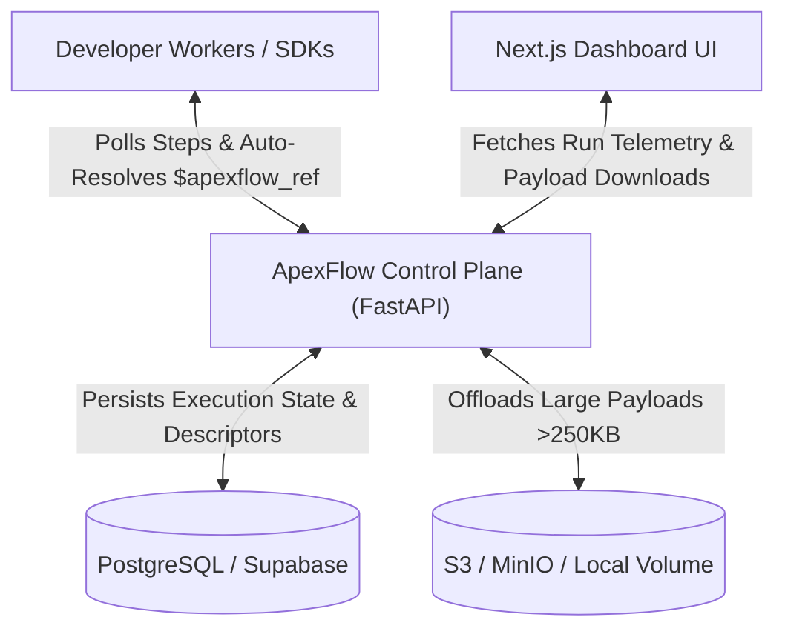

# ApexFlow 🚀

> **Code-First Durable Workflow Orchestration Engine for AI Pipelines & Distributed Microservices.**
> 
> *Reliable step execution, state checkpointing, idempotency, and real-time observability—without infrastructure overhead or queue management.*

---

## 📌 Overview

**ApexFlow** is a lightweight, code-first workflow engine and developer platform designed to replace brittle automation scripts and eliminate the operational complexity of heavy orchestration platforms (such as Temporal or Airflow).

It pairs a **Zero-Knowledge Control Plane** with lightweight SDKs to manage state checkpointing, automatic retries, deduplication, and real-time monitoring—all while business logic, API credentials, and data remain on your workers.

---

## ✨ Key Features & Capabilities

- 🔒 **Zero-Knowledge Control Plane**: Execution occurs entirely on your worker infrastructure. ApexFlow never sees or stores your raw business data, model keys, or DB passwords.
- ⚡ **PostgreSQL-Powered Queue (`FOR UPDATE SKIP LOCKED`)**: High-throughput distributed step queueing using PostgreSQL row-level locks—no Redis, Celery, or SQS required.
- 🔄 **Durable Checkpointing & Resilient Retries**: Steps are memoized on completion. If a multi-step pipeline fails on Step 4, ApexFlow skips completed steps (1–3) on restart and retries only the failed step.
- 🔑 **Built-In Deduplication & Idempotency (`deduplication_id`)**: Prevents duplicate executions from webhook retries or parallel triggers at the database level.
- 👥 **Multi-Worker Concurrency & Lock Recovery**: Parallel worker polling with automatic lease expiration and stale lock recovery if a worker process crashes mid-execution.
- 🌲 **Parent-Child Sub-Workflow Lineage**: Supports launching sub-workflows (`parent_workflow_id`) with complete execution tree visibility.
- 📦 **250KB Payload Offloading & Object Storage Adapters**: Enforces a 250KB threshold policy on DB `jsonb` fields. Payloads $>250\text{ KB}$ are offloaded to S3/MinIO or durable local disk fallback (`.apexflow_storage/`), leaving lightweight `$apexflow_ref` descriptors auto-resolved by SDKs.
- 🧹 **Dual Storage Pruning (`pg-cron`)**: 7-day payload soft clearing + 30-day batched hard deletion keep database storage lean on free-tier PostgreSQL instances.
- 📊 **Real-Time Next.js Dashboard**: Visual status badges, step duration metrics, Error Inspector Modal with diagnostic tracebacks, Payload Offload Inspector modal with download actions, and interactive control actions (`Cancel Run`, `Restart Run`).

---

## 🏗️ Architecture



---

## 📁 Repository Structure

```text
apex-flow/
├── apex-flow-backend/       # FastAPI Control Plane REST API, Queue Engine, & Storage Adapters
├── apex-flow-dashboard/     # Modern Next.js 14 Telemetry & Observability Dashboard
├── sdks/
│   └── python/              # Python SDK (`apex-flow-sdk`), StorageResolver, & E2E Suite
├── migrations/              # PostgreSQL SQL migrations & pg-cron pruning routines
└── docs/                    # Architectural Specifications & Component Docs
```

---

## 🚀 Quickstart

### 1. Launch Backend Control Plane
```bash
cd apex-flow-backend
./dev.sh
# Control Plane API running at http://127.0.0.1:8000
# OpenAPI Swagger docs at http://127.0.0.1:8000/docs
```

### 2. Launch Observability Dashboard
```bash
cd apex-flow-dashboard
npm run dev
# Open http://localhost:3000 in your browser
```

### 3. Run SDK Workflow Walkthroughs
```bash
cd sdks/python/examples
./run.sh ecom          # Successful order fulfillment walkthrough
./run.sh ecom --fail   # Failure simulation & error inspector demonstration
./run.sh sub           # Parent & child sub-workflow lineage demo
./run.sh large         # Large payload offloading demo (>250KB threshold)
```

---

## 📚 Documentation Links

- ⚙️ **[Backend Control Plane Specs](docs/BACKEND_README.md)**: API architecture, queue engines, and multi-tenant security model.
- 📦 **[SDK Specification](docs/SDK_README.md)**: Language-agnostic SDK client requirements, checkpointing concepts, and retry resilience.
- 🔄 **[Workflow Mechanics & Lifecycle](docs/WORKFLOW_SPEC.md)**: Workflow lifecycle state machines, step lifecycles, and queue polling mechanics.
