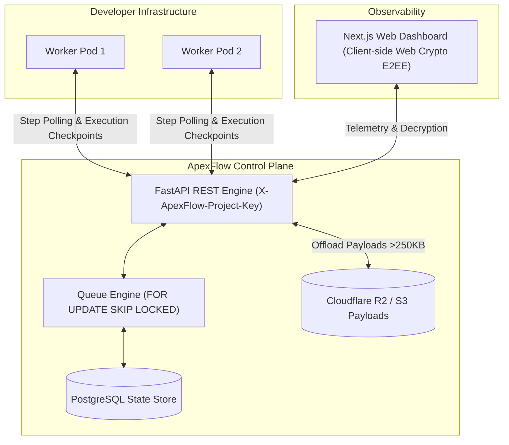

# ApexFlow ⚡

> **Code-first durable workflow orchestration with zero infrastructure to manage.**  
> *The developer ergonomics of DBOS, paired with a turnkey, zero-knowledge cloud control plane.*

---

## 📌 Why ApexFlow?

Most workflow orchestration engines force you into a frustrating trade-off:
- **Temporal & AWS Step Functions**: Powerful, but burdened with heavy operational complexity (Cassandra, Elasticsearch, complex clusters, and verbose DSLs).
- **DBOS Transact**: Excellent code-first developer experience, but requires coupling every worker directly to your PostgreSQL database with open ports and custom migrations.
- **Celery + Redis**: Fragile task queues without step-level checkpointing, state machines, or built-in observability.

**ApexFlow gives you the best of both worlds**:
Write clean, idiomatic Python code with native functions and Pydantic models. Connect your workers via a single API key (`af_live_...`). ApexFlow handles state persistence, queue coordination, automatic payload offloading, and visual observability—with **zero infrastructure to manage**.

---

## ⚖️ How ApexFlow Compares

| Feature | ApexFlow ⚡ | DBOS Transact | Temporal.io | Celery + Redis |
| :--- | :---: | :---: | :---: | :---: |
| **Developer Ergonomics** | **Code-First (Python)** | Code-First (Python/TS) | Complex SDK / DSL | Decorator-based |
| **Infrastructure Setup** | **Zero Ops (REST API Key)** | Direct PostgreSQL Connection | Heavy (Clusters + ES) | Medium (Redis / RabbitMQ) |
| **Durable Step Resumption** | ✅ **Yes** | ✅ **Yes** | ✅ **Yes** | ❌ No (Whole task fails) |
| **Zero-Knowledge Encryption** | ✅ **AES-256-GCM Client E2EE** | ❌ No | ❌ Custom data converter | ❌ No |
| **Turnkey Web Dashboard** | ✅ **Included (Next.js)** | ❌ No native cloud UI | ✅ Heavy Web UI | ⚠️ Basic (Flower) |
| **Automatic Large Payload Offload**| ✅ **R2 / S3 ($>250\text{ KB}$)** | ❌ Manual | ⚠️ 2MB hard ceiling | ❌ Broker payload bloat |
| **Time-Travel Debugging & Forking**| ✅ **`POST .../fork`** | ✅ Supported | ⚠️ Replay only | ❌ No |

---

## ✨ Key Capabilities

- 🔄 **Durable Step Checkpointing**: Each step is memoized upon completion. If a 5-step pipeline fails at Step 4, restarting it skips Steps 1–3 and resumes instantly at Step 4.
- 🔁 **Loop-Safe Execution**: Step identity is scoped to `(step_name, step_order)`, guaranteeing safe step memoization inside `for` and `while` loops.
- 🔒 **Zero-Knowledge Payload Encryption (E2EE)**: Sensitive payloads are encrypted on the worker using authenticated AES-256-GCM before transmission. The control plane and storage hold only ciphertext, decrypted client-side in the dashboard via Web Crypto API.
- ⚡ **PostgreSQL-Powered Queue Engine**: High-throughput distributed dequeuing using `FOR UPDATE SKIP LOCKED`—no Redis, Kafka, or SQS required.
- ⏱️ **Advanced Flow Control & Scheduling**:
  - **Scheduled Delays**: Step-level `delay_seconds` and server-scheduled exponential backoff retries.
  - **Workflow Deadlines**: Run-level `timeout_seconds` automatically fail stalled pipelines.
  - **Priority Queuing**: Integer `priority` parameters prevent starvation from high-volume batch workloads.
  - **Trigger Debouncing**: Coalesces rapid webhook bursts sharing a `deduplication_id` into a single execution.
  - **Time-Travel Forking**: Clone prior step checkpoints and branch execution from any failed step.
- 📦 **Transparent Large Payload Offloading**: Payloads $>250\text{ KB}$ (up to $2\text{ MB}$) are automatically offloaded to Cloudflare R2 / S3 with lightweight `$apexflow_ref` pointers dereferenced transparently by the SDK.
- 💓 **Worker Heartbeat & Liveness Monitoring**: Real-time worker health telemetry with automatic lease recovery (`locked_until`) if a worker drops offline.
- 📊 **Next.js Observability Dashboard**: Full execution timelines, error tracebacks, live worker status, and encrypted payload inspection.

---

## 💻 30-Second Example

```python
from apex_flow_sdk import ApexFlowClient, WorkflowContext

# 1. Initialize client with your project key
client = ApexFlowClient(project_key="af_live_your_key_here")

# 2. Define workflow with durable steps
@client.workflow(name="user-onboarding-pipeline")
async def onboard_user(ctx: WorkflowContext, payload: dict):
    # Step 1: Create billing account (memoized on completion)
    account = await ctx.step(
        "create-stripe-customer",
        lambda: {"customer_id": f"cus_{payload['email'].split('@')[0]}"},
    )

    # Step 2: Provision cloud workspace (with automatic retries)
    workspace = await ctx.step(
        "provision-workspace",
        lambda: {"workspace_url": f"https://app.example.com/{account['customer_id']}"},
        max_attempts=3,
    )

    # Step 3: Send confirmation notification
    await ctx.step(
        "send-welcome-email",
        lambda: {"email_sent": True, "to": payload["email"]},
    )

    return {"status": "active", "workspace": workspace}

# 3. Trigger or start worker
if __name__ == "__main__":
    import asyncio
    asyncio.run(client.start_worker())
```

---

## 🏗️ Architecture



---

## 📁 Repository Structure

```text
apex-flow/
├── apex-flow-backend/       # FastAPI Control Plane REST API, Queue Engine & Adapters
├── apex-flow-dashboard/     # Next.js 14 Observability Dashboard & Web Crypto E2EE Inspector
├── sdks/
│   └── python/              # Python SDK (`apex-flow-sdk`), StorageResolver & Serialization
├── migrations/              # PostgreSQL schema migrations & retention routines
└── docs/                    # Specifications & Deployment Guides
```

---

## 🚀 Quickstart

### 1. Start Control Plane Backend
```bash
cd apex-flow-backend
./dev.sh
# REST API running at http://127.0.0.1:8000
# OpenAPI Docs at http://127.0.0.1:8000/docs
```

### 2. Start Observability Dashboard
```bash
cd apex-flow-dashboard
npm run dev
# Dashboard running at http://localhost:3000
```

### 3. Run SDK Walkthroughs
```bash
cd sdks/python/examples
./run.sh ecom          # E-Commerce order pipeline
./run.sh sub           # Parent-child sub-workflow lineage
./run.sh large         # Transparent payload offload demo (>250KB)
./run.sh enc           # Zero-Knowledge client-side AES-256-GCM encryption
./run.sh hb            # Worker heartbeat & liveness monitoring
```

---

## 📚 Documentation

- 📦 **[SDK Specification](docs/SDK_README.md)**: Python SDK architecture, serialization, and client protocols.
- ⚙️ **[Backend Control Plane Guide](docs/BACKEND_README.md)**: REST endpoints, database schema, and queue mechanics.
- 🔄 **[Workflow & Step Specification](docs/WORKFLOW_SPEC.md)**: Lifecycle state machines, sub-workflow cascading, and time-travel forking.
- 🚀 **[Production Deployment Guide](docs/DEPLOYMENT_GUIDE.md)**: Deploying to Render, Vercel, or self-hosted Docker Compose.
