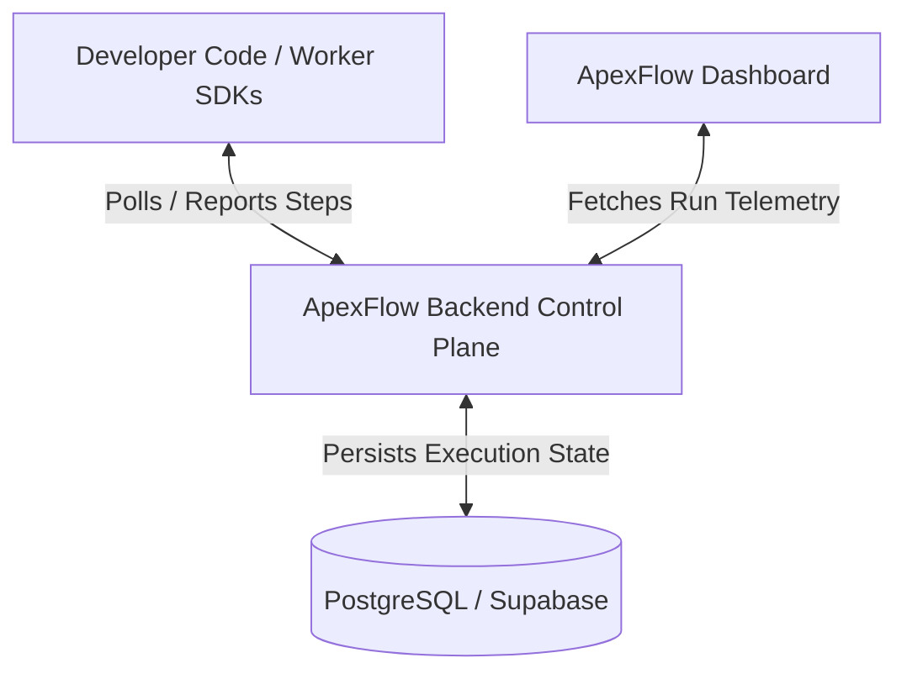

# ApexFlow: Lightweight Code-First Workflow Orchestration Engine

> **Reliable Execution, State Management, and Observability for AI and External API Workflows — Without Infrastructure Bottlenecks or Queue Management.**

---

## 📌 Project Overview

**ApexFlow** is a code-first developer tool and SDK designed to bridge the gap between brittle local automation scripts and heavyweight infrastructure workflow engines (like Temporal or Airflow).

It provides a **lightweight, zero-knowledge control plane** to orchestrate multi-step workflows, manage step-level state checkpointing, automatically execute retries, and deliver real-time visual monitoring—all while keeping code execution, database credentials, and LLM API keys entirely within the developer's local or hosted workers.

---

## 💥 Problem Statement & Solution

### The Bottlenecks
1. **The Mid-Chain Failure Trap**: In a multi-step script chaining LLM extraction and external APIs (e.g., Stripe, Salesforce), a failure on step 4 crashes the entire script, forcing complex custom database logging or full manual reruns.
2. **Infrastructure Overhead**: Running distributed background tasks usually requires configuring Redis, Celery, RabbitMQ, or SQS queues, creating maintenance burden for lean teams.
3. **Black-Box Monitoring**: Debugging asynchronous pipelines using standard terminal logs is painful, noisy, and inefficient.

### The ApexFlow Solution
ApexFlow operates on a **Zero-Knowledge Control Plane Architecture**:
- 🔒 **Bring Your Own Worker & Keys**: Execution happens exclusively on the developer's infrastructure using local environment variables and API keys. ApexFlow never touches raw user data or model credentials.
- 🔑 **API Key Security & Multi-Tenant Isolation**: Secure control plane communication using SHA-256 hashed Project API Keys (`af_live_...`) for workers and Supabase JWTs for dashboard management.
- 🔄 **Durable Step Execution**: Workflows are broken into modular steps. When a step fails, ApexFlow retries **only the failed step** using automated state memoization, bypassing previously completed steps.
- ⚡ **Lightweight Queue Management**: Uses database row locking (`FOR UPDATE SKIP LOCKED`) in PostgreSQL to sequence and dispatch task steps to workers without requiring Redis.
- 📊 **Real-Time Auditing**: Interactive dashboard displays workflow execution timelines, step durations, status badges, and input/output payload histories.

---

## 🏗️ System Architecture & Specifications

ApexFlow is organized as a modular monorepo consisting of three primary components:

### Sub-System Technical Specifications:

- ⚙️ **Backend Control Plane**: Detailed REST API routes, PostgreSQL schema definitions, and layer architecture are documented in [BACKEND_README.md](file:///home/ovi/Desktop/Project/Web/apex-flow/docs/BACKEND_README.md).
- 📦 **Multi-Language SDKs**: Control plane connection protocols, required SDK capabilities, and language package standards are documented in [SDK_README.md](file:///home/ovi/Desktop/Project/Web/apex-flow/docs/SDK_README.md).
- 🔄 **Workflow Mechanics & Queueing**: Sequence diagrams, state machines, and `FOR UPDATE SKIP LOCKED` database queue specs are documented in [WORKFLOW_SPEC.md](file:///home/ovi/Desktop/Project/Web/apex-flow/docs/WORKFLOW_SPEC.md).
