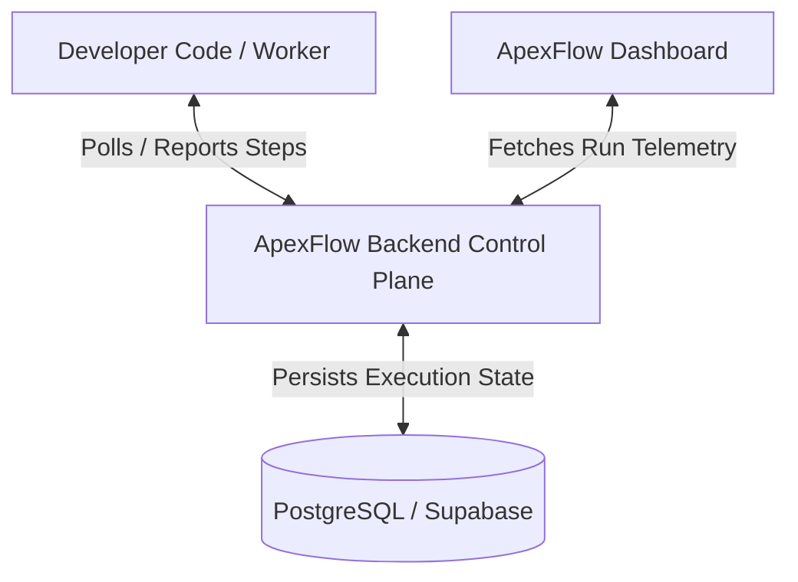

# ApexFlow: Lightweight Code-First Workflow Orchestration Engine

> **Reliable Execution, State Management, and Observability for AI and External API Workflows — Without Infrastructure Bottlenecks or Queue Management.**

---

## 📌 Project Overview

**ApexFlow** is a code-first developer tool and SDK designed to bridge the gap between brittle local automation scripts and heavyweight infrastructure workflow engines (like Temporal or Airflow).

It provides a **lightweight, zero-knowledge control plane** to orchestrate multi-step workflows, manage step-level state checkpointing, automatically execute retries, and deliver real-time visual monitoring—all while keeping code execution, database credentials, and LLM API keys entirely within the developer's local or hosted workers.

> [!NOTE]
> **Flexibility Notice**: The core philosophy, security model, and functionality described in this document are established foundational pillars. Specific stack components, API schemas, and feature roadmap details can evolve and adapt as implementation progresses. Code snippets provided are conceptual illustrations.

---

## 💥 Problem Statement & Solution

### The Bottlenecks
1. **The Mid-Chain Failure Trap**: In a multi-step script chaining LLM extraction and external APIs (e.g., Stripe, Salesforce), a failure on step 4 crashes the entire script, forcing complex custom database logging or full manual reruns.
2. **Infrastructure Overhead**: Running distributed background tasks usually requires configuring Redis, Celery, RabbitMQ, or SQS queues, creating maintenance burden for lean teams.
3. **Black-Box Monitoring**: Debugging asynchronous pipelines using standard terminal logs is painful, noisy, and inefficient.

### The ApexFlow Solution
ApexFlow operates on a **Zero-Knowledge Control Plane Architecture**:
- 🔒 **Bring Your Own Worker & Keys**: Execution happens exclusively on the developer's infrastructure using local environment variables and API keys. ApexFlow never touches raw user data or model credentials.
- 🔄 **Durable Step Execution**: Workflows are broken into modular steps. When a step fails, ApexFlow retries **only the failed step** using automated state memoization, bypassing previously completed steps.
- ⚡ **Lightweight Queue Management**: Uses database row locking (`FOR UPDATE SKIP LOCKED`) in PostgreSQL to sequence and dispatch task steps to workers without requiring Redis.
- 📊 **Real-Time Auditing**: Interactive dashboard displays workflow execution timelines, step durations, status badges, and input/output payload histories.

---

## 🏗️ System Component Architecture



### 1. Backend Control Plane (`apex-flow-backend`)
- **Role**: Coordinates workflow execution states, manages step queue sequencing, and processes worker handshakes without executing user business logic or storing sensitive model payloads.
- **Primary Technology Stack**:
  - **Framework**: FastAPI (asynchronous, high-throughput REST API with automatic OpenAPI docs).
  - **ORM & Driver**: SQLAlchemy 2.0 (Async) + `asyncpg`.
  - **Database**: PostgreSQL / Supabase (Relational integrity, row locking, JSONB storage).
  - **Migrations & Auth**: Alembic for schema migrations; Supabase Auth / JWT for multi-tenant isolation.
  - **Modular Architecture**: Layered structure with `core/`, `models/`, `schemas/`, `services/`, and `api/v1/`.

### 2. Developer SDK (`apex-flow-sdk`)
- **Role**: Lightweight client library providing intuitive function decorators and context managers to define and run stateful workflows locally.
- **Initial Implementation**: Python SDK (using `httpx` for async control plane handshakes).
- **Illustrative Example**:
  ```python
  import os
  from apex_flow_sdk import ApexFlowClient, WorkflowContext

  client = ApexFlowClient(project_key=os.getenv("APEXFLOW_PROJECT_KEY"))

  @client.workflow(name="process-lead-ai")
  async def process_lead_workflow(ctx: WorkflowContext, user_input: str):
      # Step 1: Extract data via LLM locally
      extracted_data = await ctx.step(
          "extract-lead-info",
          lambda: call_openai_api(user_input),
          retries=3,
      )

      # Step 2: Create record in CRM
      crm_id = await ctx.step(
          "create-crm-record",
          lambda: salesforce.create(extracted_data),
      )

      # Step 3: Trigger welcome email
      await ctx.step(
          "send-welcome-email",
          lambda: sendgrid.send_email(crm_id),
      )

      return {"status": "completed", "crm_id": crm_id}

  if __name__ == "__main__":
      client.start_worker()
  ```

### 3. Frontend Observation Dashboard (`apex-flow-dashboard`)
- **Role**: Real-time visual monitoring plane for inspecting workflow execution states, step-by-step performance metrics, execution timelines, and failure stack traces.
- **Primary Stack**: Next.js (React / TypeScript), Tailwind CSS, Shadcn UI, and TanStack React Query.

---

## 🗄️ Database Schema Blueprint

### `workflows` Table
Tracks master execution states and isolates workflows per user/tenant.

| Field | Type | Description |
| :--- | :--- | :--- |
| `id` | `UUID` (PK) | Unique ID for the workflow run (default: `gen_random_uuid()`). |
| `user_id` | `UUID` (FK) | References `auth.users(id)` ON DELETE CASCADE for tenant isolation. |
| `status` | `Text` | Run state: `pending`, `running`, `completed`, `failed`. |
| `metadata` | `JSONB` | Optional tags or user-defined run metadata. |
| `created_at` | `TIMESTAMPTZ` | Timestamp when workflow was triggered. |
| `updated_at` | `TIMESTAMPTZ` | Timestamp of last status modification. |

### `workflow_steps` Table
Acts as step execution log and distributed queue via `FOR UPDATE SKIP LOCKED`.

| Field | Type | Description |
| :--- | :--- | :--- |
| `id` | `UUID` (PK) | Unique step execution ID. |
| `workflow_id` | `UUID` (FK) | Parent workflow run ID (`workflows.id`). |
| `step_name` | `Text` | Step identifier (e.g., `extract-lead-info`). |
| `status` | `Text` | Step state: `queued`, `running`, `success`, `failed`. |
| `attempt_count` | `Integer` | Retry attempt counter. |
| `input_payload` | `JSONB` / `Text` | Input parameters or payload pointer reference. |
| `output_payload` | `JSONB` / `Text` | Step return value or storage pointer. |
| `error_message` | `Text` | Failure reason or stack trace snippet. |
| `created_at` | `TIMESTAMPTZ` | Timestamp when step was queued. |
| `updated_at` | `TIMESTAMPTZ` | Timestamp of last status update. |

---

## 📁 System Project Structure

```text
apex-flow/                          # System Workspace Root
├── docs/                           # Documentation & Specifications
│   ├── README.md                   # System Documentation (This file)
│   ├── WORKFLOW_SPEC.md            # Detailed Workflow Orchestration Mechanics
│   └── Project Apex_...pdf         # Initial Proposal Specification
├── apex-flow-backend/              # FastAPI Control Plane Sub-Project
│   ├── app/
│   │   ├── api/v1/                 # Thin HTTP Routers (workflows, steps, health)
│   │   ├── core/                   # Infrastructure (config, database, exceptions)
│   │   ├── models/                 # SQLAlchemy ORM Models (Workflow, WorkflowStep)
│   │   ├── schemas/                # Pydantic Validation Schemas
│   │   ├── services/               # Domain Business Logic & Queue Services
│   │   └── main.py                 # FastAPI Application Entrypoint
│   ├── tests/                      # Automated Integration & Unit Tests
│   ├── requirements.txt            # Python Dependencies
│   └── pytest.ini                  # Pytest Configuration
├── apex-flow-sdk/                  # Python SDK Sub-Project (Upcoming)
└── apex-flow-dashboard/            # Next.js Dashboard Sub-Project (Upcoming)
```
