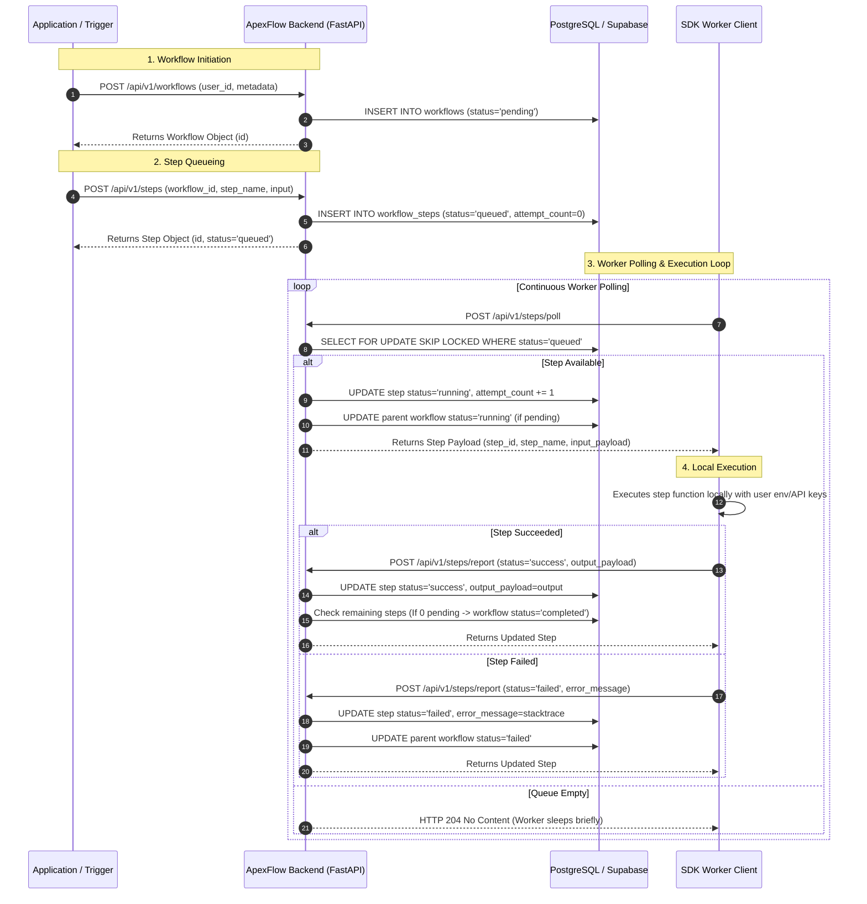

# ApexFlow: Technical Workflow & Queue Specification

> **Backend Orchestration Mechanics, PostgreSQL Row-Locking Queue (`FOR UPDATE SKIP LOCKED`), and Worker Protocol.**

---

## 🔄 Workflow Execution Lifecycle Sequence

The diagram below illustrates the exact sequence of interactions between the **Trigger Application**, **ApexFlow Backend Control Plane**, **PostgreSQL Database**, and **SDK Worker Instances**:



---

## 📊 State Machine & Status Transitions

### 1. Workflow Master State Machine
- `pending`: Workflow run has been created; no steps have started executing.
- `running`: At least one step has been picked up by a worker.
- `completed`: All queued steps for the workflow run returned `success`.
- `failed`: At least one step returned `failed` (or retry limits were exhausted).

```text
[ pending ] ──(worker polls first step)──> [ running ] ──┬──(all steps success)──> [ completed ]
                                                         └──(step fails)─────────> [ failed ]
```

### 2. Step Execution State Machine
- `queued`: Step is registered and awaiting an available worker.
- `running`: Step has been acquired by a worker via `FOR UPDATE SKIP LOCKED`.
- `success`: Worker successfully executed local step function.
- `failed`: Worker encountered an unhandled exception or non-retryable error.

```text
[ queued ] ──(SELECT FOR UPDATE SKIP LOCKED)──> [ running ] ──┬──(report success)──> [ success ]
                                                              └──(report failure)──> [ failed ]
```

---

## ⚡ Concurrency & Queueing Mechanics (`FOR UPDATE SKIP LOCKED`)

ApexFlow uses PostgreSQL's native row-level locking capabilities to deliver distributed message queuing without requiring external infrastructure (like Redis, RabbitMQ, or Celery).

### How it operates in `app/services/step_service.py`:

```python
stmt = (
    select(WorkflowStep)
    .where(WorkflowStep.status == "queued")
    .order_by(WorkflowStep.created_at.asc())
    .limit(1)
    .with_for_update(skip_locked=True)
)
```

1. **Isolation**: When multiple SDK workers send concurrent `POST /api/v1/steps/poll` requests, `with_for_update(skip_locked=True)` ensures that each worker locks a unique queued step.
2. **Non-Blocking**: Workers never wait for another worker's lock; if a row is currently locked by Worker A, Worker B automatically skips it and locks the next available row.
3. **Atomicity**: The step status transition to `running` and `attempt_count` increment happen within the locked transaction before releasing.

---

## 🌐 Control Plane REST API Contract Summary

| Endpoint | Method | Purpose | Response |
| :--- | :--- | :--- | :--- |
| `/api/v1/health` | `GET` | Lightweight liveness check (0 DB queries). | `{"status": "ok"}` |
| `/api/v1/health/db` | `GET` | Readiness check verifying PostgreSQL ping. | `{"status": "online", "database": "healthy"}` |
| `/api/v1/workflows` | `POST` | Create a new master workflow run. | `WorkflowDetailResponse` (`201 Created`) |
| `/api/v1/workflows` | `GET` | List workflow runs (paginated, user filterable). | `List[WorkflowResponse]` |
| `/api/v1/workflows/{id}` | `GET` | Fetch workflow run details & step timeline history. | `WorkflowDetailResponse` |
| `/api/v1/steps` | `POST` | Queue a new step under a workflow. | `WorkflowStepResponse` (`201 Created`) |
| `/api/v1/steps/poll` | `POST` | Worker polls for next queued step via row-locking. | `WorkflowStepResponse` or `204 No Content` |
| `/api/v1/steps/report` | `POST` | Worker reports step execution result (`success`/`failed`). | `WorkflowStepResponse` |

---

## 🚀 Adaptability & Future Expansion

- **Pointer Pattern**: For large inputs or outputs (>64KB or binary files), the worker/backend offloads raw data to S3 or Supabase Storage, passing only secure URL pointers in `input_payload` and `output_payload`.
- **Dynamic DAG Graphing**: The backend step queue is built to support dependent step execution graphs (where Step C waits for both Step A and Step B to return `success`).
- **Multi-Language SDKs**: The `/poll` and `/report` REST protocol expects only generic JSON primitives, enabling TypeScript, Go, or Java workers to participate in the exact same execution queue.
